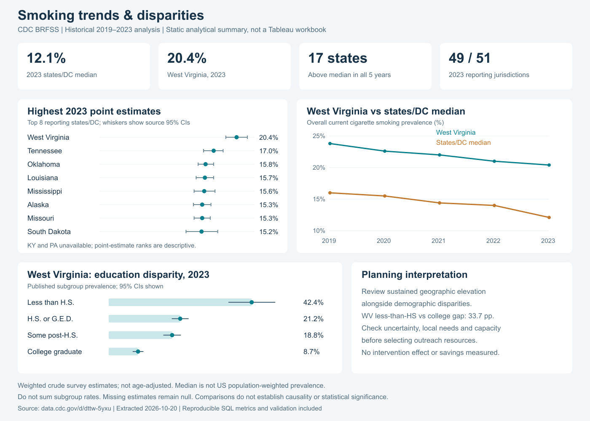

# Population Health Analytics: Smoking Trends & Disparities

Independent analytics portfolio project | Python • SQL (SQLite) • Tableau-ready data and dashboard specification

## Decision question
Which reporting states have persistently elevated adult cigarette smoking prevalence, and which demographic gaps warrant closer assessment before selecting outreach priorities?

Audience: an illustrative public-health program analyst or planning manager. This is an independent portfolio analysis, with no client, deployment, intervention, or measured operational outcome claimed.

## What is complete
- Preserved CDC JSON extract: **7,192 aggregate estimate records**, 2019–2023, including territories and CDC median records.
- Reproducible Python ingestion and SQLite database; executable SQL uses joins, CTEs, CASE, GROUP BY, RANK and LAG.
- Analysis scoped to 50 states plus DC: **251 available overall state-year estimates**, **6,575 demographic estimate rows** (including unavailable cells).
- Six Tableau-ready CSVs, calculated metrics, missingness coverage, reproducibility manifest, automated checks, findings, static visual summary, and detailed Tableau build specification.

**Tableau status:** no native `.twb`/`.twbx` workbook has been built or opened in Tableau, and nothing has been published to Tableau Public. The dashboard image is a static Python visualization. Native Tableau implementation is documented in [the dashboard specification](tableau/DASHBOARD_SPEC.md).

## Compact project plan and workflow
1. **Frame:** define descriptive comparisons, time window, audience and decision limitations.
2. **Acquire:** filter CDC API to `_RFSMOK3`, response `Yes`, years 2019–2023; archive the original JSON and its hash. This intentionally bounded historical window is not a claim to use the newest CDC observations.
3. **Model:** retain original fields in `raw_estimates`, normalize types/nulls in a SQL view, and join a 51-row geographic dimension. Grain is year × location × breakout category × breakout, for one indicator and response.
4. **Validate:** check key uniqueness, bounds, confidence intervals, source reconciliation, missing state-years, source hash and database integrity; independently recompute all overall YoY metrics in Python.
5. **Analyze in SQL:** calculate year-specific ranks, changes, median gaps, education/sex reference comparisons and complete-case persistent elevation.
6. **Communicate:** produce findings and visual summary; supply CSVs and worksheet-by-worksheet Tableau instructions. Native Tableau implementation is the remaining optional portfolio presentation step.

## Findings
- In 2023, **West Virginia had the highest point estimate among the 49 reporting states/DC jurisdictions: 20.4% (95% CI 18.8–22.0)**. It was **8.3 percentage points** above the CDC states/DC median of 12.1%. Kentucky and Pennsylvania are missing; this is not a complete 51-jurisdiction ranking.
- CDC's reported states/DC median decreased from **16.0% in 2019 to 12.1% in 2023**, a **3.9-point** change. It is not a population-weighted US prevalence estimate, and reporting coverage changes by year.
- **17 states** exceeded their same-year states/DC median in all five years, requiring five available observations. The list supports a sustained-elevation review rather than relying only on a single-year rank.
- In West Virginia in 2023, adults with less than high school education had a **42.4%** point estimate versus **8.7%** among college graduates: a **33.7-point gap**, approximately **4.87×**. This was the largest observed less-than-HS/college gap among available 2023 pairs. It is descriptive; the ranking does not establish statistically distinct disparities.
- Louisiana's available overall point estimate fell from **21.9% to 15.7%** between 2019 and 2023 (**−6.2 points**), the largest decline among available matched endpoints. This does not attribute the change to any intervention.

## Decision support
An analyst could begin reviewing West Virginia because it combines a high observed overall estimate, persistent elevation and a large observed education disparity. Next examine uncertainty, local needs, population counts, program coverage and delivery capacity before committing resources. High prevalence alone does not establish the greatest number of people affected or the best return on spending. No intervention outcome, cost saving, or user adoption was measured.

## Metric dictionary
| Metric | Definition | Interpretation / guardrail |
|---|---|---|
| Smoking prevalence (%) | CDC `data_value`, crude weighted prevalence for `_RFSMOK3=Yes` | Published survey estimate, not recomputed from sample counts |
| YoY change (pp) | Current prevalence − previous calendar year's prevalence | SQL `LAG`; null if preceding year is absent or unavailable |
| YoY relative change (%) | 100 × (current − prior) / prior | Separate from percentage points; null for unavailable/zero prior |
| State-year rank | `RANK` descending on available overall prevalence | Includes DC; ties share rank; excludes territories and median rows |
| Gap vs states/DC median (pp) | State prevalence − CDC `UW` overall median | Median comparison, not US weighted population benchmark |
| Change since 2019 (pp) | Current − same state's available 2019 overall estimate | Missing baseline stays null |
| Education reference gap / ratio | Segment prevalence − / ÷ college graduate prevalence, same state/year | No causal or significance claim |
| Sex reference gap / ratio | Segment prevalence − / ÷ female prevalence, same state/year | Explicit analytical reference, not a normative benchmark |
| Gap vs state overall (pp) | Subgroup prevalence − same state/year overall prevalence | Not a gap between independent samples; subgroup is included in overall |
| Observed subgroup range (pp) | Maximum − minimum available prevalence in a category/state/year | Export includes availability count and partial/complete flag |
| Persistent elevation | All 5 years available and prevalence above same-year median in each | Descriptive review flag, not a predictive risk score |
| Coverage | Available overall estimates / 51 expected jurisdictions per year | Show as counts, e.g. 49/51 in 2023 |

All rate fields use **0–100**, not fractions. Display 20.4 as `20.4%`, not `2040%`. Prevalence values were already rounded by CDC; avoid overstating arithmetic precision.

## Data quality and limitations
- Null/unavailable estimates remain null, never zero. Of all 7,192 extracted records, **1,222** have unavailable prevalence values. Source notes preserve suppression and no-response explanations.
- Expected state-year grid: 255; available: 251. Missing source rows: NJ 2019, FL 2021, KY 2023, PA 2023. These are extract observations; only KY/PA 2023 were independently checked against CDC annual documentation.
- CDC footnotes specify suppression when the unweighted denominator is below 50 or RSE exceeds 0.3, or no data were collected. Do not apply a second suppression rule using `sample_size`; its source meaning is not assumed to be the denominator.
- Household income categories changed in 2021 (`$50,000+` becomes several higher-income bands). Compare within a selected year; no cross-year income trends or merged rates are built.
- Breakout categories overlap. A sex row and an education row cannot be added or treated as a joint sex-by-education segment. No intersectional estimates are available here.
- Crude estimates are survey-weighted but not age-standardized. Demographic composition may explain part of geographic differences. Aggregate data cannot support individual prediction, causal claims, new survey weighting, or population counts.
- Confidence intervals belong to CDC prevalence estimates. Gap/ratio confidence intervals, significance tests and multiplicity adjustment have not been calculated. Displayed ranks are point-estimate ranks.
- No simple average of subgroup/state rates is used to create a population rate. CDC median rows `US` (includes territories) and `UW` (states/DC) differ; only `UW` is used as the comparison benchmark.

## Reproduce
From this directory, run `python3 run_analysis.py` with Python 3.9+ and SQLite 3.25+. No third-party Python packages or network are required for the analysis rebuild. This creates/replaces the SQLite database, CSV exports, results and validation JSON using the archived raw snapshot.

To deliberately download a new version of the same historical window: `python3 run_analysis.py --refresh`. This requires internet access, replaces the snapshot/manifest and may change results. The narrative and image are snapshot-specific and must be reviewed after refresh. A 50,000-row limit assertion prevents silently accepting a full page; add pagination if the scope is expanded.

`python3 make_visual_summary.py` regenerates the static SVG summary using only the Python standard library. A PNG rendering of that SVG is included for convenient viewing. The image was rasterized with Sharp and visually reviewed; Sharp is not needed to reproduce the SVG or the analysis.

## Files
- `sql/analysis.sql`: all transformation and metric definitions.
- `run_analysis.py`: source ingestion, SQL execution, CSV export and verification.
- `data/`: preserved original JSON and source manifest with query/hash. The SQLite database is generated locally when the analysis runs.
- `tableau/`: six CSVs and `DASHBOARD_SPEC.md` with import instructions, controls, metrics and acceptance checks.
- `reports/`: validation JSON, computed findings JSON and static dashboard summary image.

## Sources
Accessed October 20, 2026.
- CDC BRFSS Prevalence Data (2011 to present), dataset `dttw-5yxu`: https://data.cdc.gov/d/dttw-5yxu
- Exact API query, row count and SHA-256: `data/source_manifest.json`.
- CDC 2023 BRFSS documentation, including weighting and missing KY/PA coverage: https://www.cdc.gov/brfss/annual_data/annual_2023.html
- CDC calculated variable documentation (definition of `_RFSMOK3`): https://www.cdc.gov/brfss/annual_data/2023/pdf/2023-calculated-variables-version4-508.pdf

The current cigarette smoking construct refers to adults who have smoked at least 100 cigarettes in their lifetime and currently smoke every day or some days. This analysis does not measure all tobacco products or vaping.
